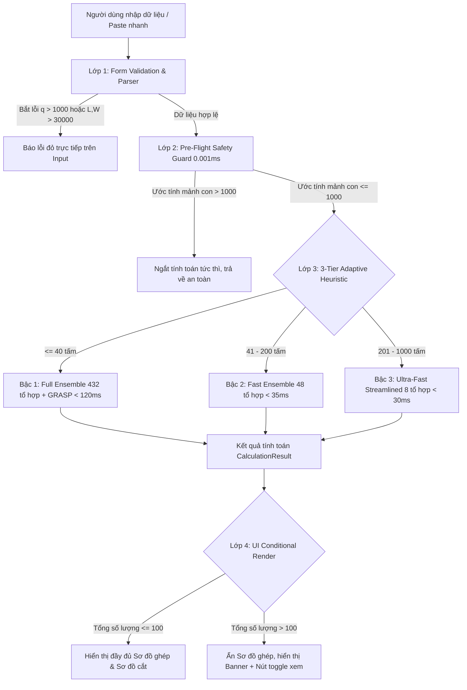

# Thiết Kế Nâng Giới Hạn 1.000 Tấm & Tối Ưu Hóa Hiển Thị Đơn Hàng Lớn Trang Wood-Cut

## 1. Tổng Quan & Mục Tiêu

Hệ thống tính toán cắt ván gỗ hiện tại đang khống chế giới hạn cứng tối đa $500$ mảnh con (`MAX_TOTAL_SUBPIECES = 500`) và $500$ tấm trên mỗi loại (`MAX_QUANTITY_PER_PIECE = 500`). Khi người dùng có nhu cầu xử lý các đơn hàng lớn hơn (lên tới $1.000$ tấm), hệ thống cần:
1. Nâng trần giới hạn an toàn lên **1.000 tấm** cho cả form nhập liệu lẫn thuật toán tối ưu.
2. Tối ưu thời gian xử lý của thuật toán để khi đơn hàng đạt ngưỡng lớn ($201 - 1000$ tấm), thời gian tính toán vẫn duy trì $< 35\text{ms}$ trên luồng chính (Main Thread), không gây giật/lag khi người dùng thao tác.
3. Tối ưu hóa tải DOM trên giao diện: Khi tổng số lượng mặt gỗ yêu cầu $> 100$ tấm, tự động ẩn danh sách các thẻ "Sơ Đồ Cấu Trúc & Ghép Từng Mặt Gỗ" ([`JoinedPieceDiagramView`](file:///C:/WORKSPACE/TaskManagementWeb/my-task-app/src/components/wood-cut/JoinedPieceDiagramView.tsx)), thay bằng banner thông báo nhẹ nhàng kèm tùy chọn mở nếu người dùng muốn xem.

---

## 2. Ma Trận Giới Hạn Đầu Vào Cập Nhật (Updated Constraints Matrix)

| Đối tượng | Trường dữ liệu | Min | Max cũ | Max mới | Hành vi xử lý |
| :--- | :--- | :---: | :---: | :---: | :--- |
| **Mặt Gỗ (`RequiredPiece`)** | Số lượng chi tiết ($q$) | $1$ | $500$ | **$1000$** | `NumericInput` & Parser chặn nếu $> 1000$ |
| | Tổng số mảnh con (`subpieces`) | $1$ | $500$ | **$1000$** | Pre-Flight Guard ngắt tức thì nếu $> 1000$ |
| | Số loại chi tiết (Rows) | $1$ | $100$ | $100$ | Chặn không cho thêm quá 100 dòng |
| | Kích thước ($L, W$) | $10\text{mm}$ | $30,000\text{mm}$ | $30,000\text{mm}$ | Báo lỗi nếu $\le 0$ hoặc $> 30,000$ |
| **Ván Gốc (`StockSheet`)** | Kích thước ($L, W$) | $100\text{mm}$ | $10,000\text{mm}$ | $10,000\text{mm}$ | Chặn không vượt quá 10m |
| **Cấu hình (`Config`)** | Mạch cưa (`kerf`) | $0\text{mm}$ | $50\text{mm}$ | $50\text{mm}$ | Giới hạn trong $[0, 50]$ |

---

## 3. Kiến Trúc Giải Pháp Chi Tiết



---

## 4. Chi Tiết Triển Khai Kỹ Thuật

### 4.1. Tầng Thuật Toán & Giới Hạn (`src/lib/woodCuttingOptimizer.ts`)

1. Cập nhật `INPUT_LIMITS`:
   ```typescript
   export const INPUT_LIMITS = {
     MIN_STOCK_DIM: 100,
     MAX_STOCK_DIM: 10000,
     MIN_PIECE_DIM: 10,
     MAX_PIECE_DIM: 30000,
     MAX_QUANTITY_PER_PIECE: 1000,
     MAX_TOTAL_SUBPIECES: 1000,
     MAX_KERF: 50,
   };
   ```

2. Cập nhật `Pre-Flight Safety Guard`:
   - Kiểm tra `estimatedSubpieces > INPUT_LIMITS.MAX_TOTAL_SUBPIECES` (ngưỡng 1000).
   - Nếu vượt quá, trả về `emptyResult` trong $0.001\text{ms}$.

3. Điều phối thuật toán 3 cấp theo tải (3-Tier Adaptive Heuristic):
   - **Bậc 1 ($\le 40$ mảnh):**
     - Sắp xếp: 9 chiến lược (`AREA_DESC`, `MAX_DIM_DESC`, `MIN_DIM_DESC`, v.v.).
     - Fit: 4 quy tắc (`BSSF`, `BLSF`, `BAF`, `BPCF`).
     - Split: 6 quy tắc (`SAS`, `LAS`, `MINAS`, `MAXAS`, `SLAS`, `LLAS`).
     - Allocation: 2 kiểu (`GLOBAL_BEST_FIT`, `SHEET_BY_SHEET`).
     - `maxEnsembleTimeMs = 120ms`, GRASP tối đa 160 vòng ($< 12\text{ms}$).
   - **Bậc 2 ($41 - 200$ mảnh):**
     - Sắp xếp: 4 chiến lược (`AREA_DESC`, `MAX_DIM_DESC`, `COMBINED_PRIORITY_DESC`, `PERIMETER_DESC`).
     - Fit: 2 quy tắc (`BSSF`, `BPCF`).
     - Split: 3 quy tắc (`MINAS`, `SAS`, `MAXAS`).
     - Allocation: 2 kiểu (`GLOBAL_BEST_FIT`, `SHEET_BY_SHEET`).
     - `maxEnsembleTimeMs = 35ms`, GRASP tối đa 40 vòng ($< 8\text{ms}$).
   - **Bậc 3 ($201 - 1000$ mảnh):**
     - Sắp xếp: 2 chiến lược tinh gọn (`AREA_DESC`, `COMBINED_PRIORITY_DESC`).
     - Fit: 2 quy tắc (`BSSF`, `BPCF`).
     - Split: 2 quy tắc (`SAS`, `MINAS`).
     - Allocation: 1 kiểu (`GLOBAL_BEST_FIT`).
     - Tổng tổ hợp: $2 \times 2 \times 2 \times 1 = 8$ tổ hợp ứng viên.
     - `maxEnsembleTimeMs = 30ms`, **bỏ qua hoàn toàn lượt GRASP** để giải phóng CPU.
     - Cam kết thời gian hoàn tất trong dải $20 - 35\text{ms}$ cho đơn hàng 1.000 tấm.

---

### 4.2. Tầng Phân Tích Cú Pháp & Nhập Liệu

1. **[`woodCutParser.ts`](file:///C:/WORKSPACE/TaskManagementWeb/my-task-app/src/lib/woodCutParser.ts):**
   - Đổi kiểm tra `quantity > 1000` với thông báo: `Số lượng (${quantity}) vượt quá giới hạn tối đa (1,000 tấm/loại).`

2. **[`RequiredPiecesForm.tsx`](file:///C:/WORKSPACE/TaskManagementWeb/my-task-app/src/components/wood-cut/RequiredPiecesForm.tsx):**
   - Đặt `max={1000}` trên component `NumericInput` của cột Số lượng (SL).

---

### 4.3. Tầng Giao Diện Người Dùng (`src/app/wood-cut/page.tsx`)

1. Xác định tổng số lượng mặt gỗ yêu cầu:
   ```typescript
   const totalPiecesCount = pieces.reduce((sum, p) => sum + (Number(p.quantity) || 0), 0);
   ```

2. State quản lý hiển thị thủ công khi đơn hàng lớn:
   ```typescript
   const [forceShowJoinedDiagrams, setForceShowJoinedDiagrams] = useState(false);
   ```

3. Khi `totalPiecesCount > 100` và `!forceShowJoinedDiagrams`:
   - Ẩn khối grid các thẻ `JoinedPieceDiagramView`.
   - Hiển thị Banner thông báo:
     - Biểu tượng: `🧩`
     - Tiêu đề: *Sơ Đồ Cấu Trúc & Ghép Từng Mặt Gỗ ({result.joinedPieces.length} mặt)*
     - Nội dung: *Đơn hàng lớn (tổng {totalPiecesCount} tấm). Sơ đồ ghép chi tiết được ẩn để tối ưu hiệu năng hiển thị. Sơ đồ xẻ ván gốc và bảng BOM bên dưới vẫn hiển thị đầy đủ.*
     - Nút bấm: *"Hiển thị sơ đồ ghép chi tiết"* (khi bấm sẽ kích hoạt `setForceShowJoinedDiagrams(true)`).
4. Khi `totalPiecesCount <= 100` hoặc người dùng chủ động bấm mở:
   - Hiển thị đầy đủ grid thẻ sơ đồ ghép như thiết kế ban đầu.

---

## 5. Kế Hoạch Kiểm Thử (Testing Plan)

1. **Unit Test Thuật Toán (`woodCuttingOptimizer.test.ts` & `woodCuttingInputSanitization.test.ts`):**
   - Kiểm tra `calculateWoodCut` với đơn hàng $1.000$ tấm chạy thành công và trả về kế hoạch cắt hợp lệ.
   - Kiểm tra Pre-Flight Guard chặn chính xác khi đơn hàng đạt $1.001$ tấm.
   - Kiểm tra thời gian thực thi (Performance Benchmark): Đơn hàng 1.000 tấm phải hoàn tất $< 50\text{ms}$.
2. **Parser Test (`woodCutParser.test.ts`):**
   - Nhập `500x600 x1000` được chấp nhận hợp lệ.
   - Nhập `500x600 x1001` báo lỗi vượt ngưỡng 1.000 tấm.
3. **Integration Test UI (`src/__tests__/woodCutIntegration.test.ts`):**
   - Kiểm tra điều kiện render khi tổng số lượng $> 100$ tấm: component ẩn sơ đồ ghép và hiển thị banner thông báo.
   - Bấm nút "Hiển thị sơ đồ ghép" kích hoạt render danh sách bình thường.
