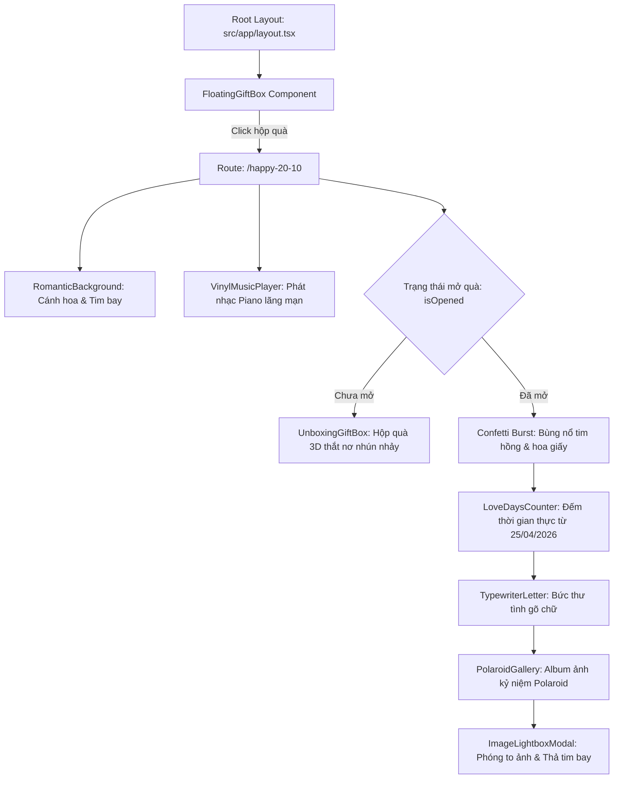

# Thiết Kế Trang Chúc Mừng 20/10 & Hộp Quà Tình Yêu (Dành Riêng Cho Thy)

## 1. Tổng Quan & Mục Tiêu

Hôm nay là ngày Phụ Nữ Việt Nam 20/10/2026. Ứng dụng hiện tại là không gian làm việc chung của hai bạn (HTPhong và Thy). Thiết kế này nhằm tạo ra một trải nghiệm chúc mừng 20/10 bất ngờ, ấm áp và đong đầy tình cảm dành riêng cho bạn gái (Thy):
1. **Hộp quà nổi (Floating Gift Box):** Xuất hiện ở góc màn hình tại mọi trang, có hiệu ứng nhún nhảy (bounce) và phát sáng lấp lánh (sparkles), bấm vào sẽ mở ra trang chúc mừng riêng.
2. **Nghi thức mở quà & Pháo hoa tim (Unboxing Ceremony):** Hộp quà 3D ở trung tâm trang `/happy-20-10` mời Thy chạm mở, nắp hộp quà mở tung kèm hiệu ứng bùng nổ tim hồng và hoa giấy lung linh.
3. **Cột mốc tình yêu & Đồng hồ đếm ngày (Love Days Counter):** Đếm chính xác số ngày, giờ, phút, giây bên nhau tính từ ngày bắt đầu quen nhau **25/04/2026** (đạt mốc 178 ngày vào ngày 20/10/2026).
4. **Bức thư tình gõ chữ (Typewriter Love Letter):** Từng câu chữ trong lời nhắn 20/10 xuất hiện sống động theo hiệu ứng gõ máy.
5. **Album ảnh kỷ niệm Polaroid (Polaroid Gallery):** Bộ sưu tập ảnh Polaroid được tuyển chọn từ `Desktop/Thy` với các bức ảnh chụp chung rạng rỡ của hai bạn, dán băng dính washi tape, hiệu ứng xoay tự nhiên và modal phóng to ảnh kèm nút thả tim bay.
6. **Âm nhạc tình yêu (Vinyl Music Player):** Widget đĩa than mini xoay tròn phát giai điệu Piano Acoustic ngọt ngào, êm dịu.

---

## 2. Kiến Trúc Hệ Thống & Cấu Trúc File

### Các file sẽ tạo mới & chỉnh sửa:
- **Tạo mới:**
  - `src/components/celebrate/FloatingGiftBox.tsx`: Widget hộp quà nổi ở góc màn hình.
  - `src/components/celebrate/LoveDaysCounter.tsx`: Đồng hồ đếm ngày yêu nhau thời gian thực từ 25/04/2026.
  - `src/components/celebrate/TypewriterLetter.tsx`: Khung thư tình hiệu ứng máy gõ chữ.
  - `src/components/celebrate/PolaroidGallery.tsx`: Album ảnh Polaroid dán băng dính washi tape.
  - `src/components/celebrate/VinylMusicPlayer.tsx`: Trình phát nhạc đĩa than mini xoay tròn.
  - `src/components/celebrate/ImageLightboxModal.tsx`: Hộp thoại xem ảnh phóng to kèm nút thả tim.
  - `src/app/happy-20-10/page.tsx`: Trang chúc mừng chính tích hợp tất cả các thành phần.
  - `public/images/celebrate-20-10/`: Thư mục lưu trữ 8 bức ảnh chọn lọc của hai bạn.
  - `public/audio/romantic-piano.mp3`: File âm thanh Piano lãng mạn.
- **Chỉnh sửa:**
  - `src/app/layout.tsx`: Nhúng component `FloatingGiftBox`.
  - `src/__tests__/celebrate2010.test.tsx`: Test case tự động cho toàn bộ tính năng.

---

## 3. Chi Tiết Từng Thành Phần

### 3.1. Hộp Quà Nổi (`FloatingGiftBox.tsx`)
- Vị trí: `fixed bottom-6 right-6 z-50`.
- Thiết kế: Box bo tròn bóng kính pastel hồng (`bg-white/90 backdrop-blur-md border border-pink-200 shadow-xl p-3 rounded-2xl`).
- Biểu tượng: Hộp quà 3D 🎁 có nơ hồng, lắc lư nhịp nhàng (`hover:rotate-12 transition-transform duration-300`).
- Hiệu ứng: 
  - Ping animation màu hồng tỏa ra xung quanh.
  - Badge nhỏ xinh: *"20/10 ✨"*.
  - Tooltip khi hover: *"Món quà 20/10 dành riêng cho em Thy 🎀"*.
- Hành vi: Click sẽ điều hướng đến `/happy-20-10` bằng Next.js `<Link>`.

### 3.2. Đồng Hồ Đếm Ngày Yêu Nhau (`LoveDaysCounter.tsx`)
- Mốc thời gian bắt đầu: `2026-04-25T00:00:00+07:00`.
- Công thức tính thời gian thực (cập nhật mỗi 1000ms):
  - $\Delta t = \text{Date.now()} - \text{startDate.getTime()}$
  - $\text{days} = \lfloor \Delta t / (1000 \times 60 \times 60 \times 24) \rfloor$ (178 ngày vào ngày 20/10/2026)
  - $\text{hours} = \lfloor (\Delta t / (1000 \times 60 \times 60)) \pmod{24} \rfloor$
  - $\text{minutes} = \lfloor (\Delta t / (1000 \times 60)) \pmod{60} \rfloor$
  - $\text{seconds} = \lfloor (\Delta t / 1000) \pmod{60} \rfloor$
- Giao diện: 4 thẻ số pastel bo tròn mềm mại (`bg-white/80 backdrop-blur-md border border-rose-200 rounded-2xl shadow-sm text-rose-600 font-extrabold`).
- Dòng chữ ngọt ngào: *"Chúng mình đã bên nhau 178 ngày và sẽ cùng nhau đi tiếp mãi sau này 💕"*.

### 3.3. Bức Thư Tình Gõ Chữ (`TypewriterLetter.tsx`)
- Hiển thị từng ký tự với tốc độ $35\text{ms}$/chữ kèm âm thanh gõ nhẹ (tùy chọn) và con trỏ nhấp nháy `|`.
- Nội dung trọn vẹn:
  > *"Gửi em yêu của anh (Thy),*
  >
  > *Hôm nay là ngày 20/10, chúc em yêu xinh đẹp của anh càng ngày càng khoẻ mạnh, xinh đẹp, để mình cùng đi tiếp tục đến mãi sau này.*
  >
  > *Yêu em rất nhiều! ❤️"*
- Nền thư: Khung viền ren hoa pastel thanh lịch với nơ ruy băng đính góc, góc bo tròn mềm mại.

### 3.4. Album Ảnh Kỷ Niệm Polaroid (`PolaroidGallery.tsx`)
- Danh sách 8 ảnh chọn lọc:
  1. `couple-radiant-smile.jpg` (`IMG_9091.jpg`): Nụ cười rạng rỡ của cả Phong & Thy dưới ánh nắng ấm áp.
  2. `couple-cute-glasses.jpg` (`120bd233...jpg`): Selfie đôi đáng yêu, nụ cười tươi tắn.
  3. `couple-cozy-cheek.jpg` (`IMG_8571.jpg`): Kề má bên nhau ấm áp và bình yên.
  4. `couple-shoulder-rest.jpg` (`IMG_8573.jpg`): Thy tựa đầu vào vai Phong, ánh mắt nụ cười hạnh phúc.
  5. `couple-chin-pose.jpg` (`IMG_8909.jpg`): Tạo dáng chống cằm đôi siêu dễ thương.
  6. `thy-gentle-smile.jpg` (`IMG_9099.jpg`): Nụ cười dịu dàng và ánh mắt lấp lánh của Thy.
  7. `thy-peace-sign.jpg` (`IMG_9092.jpg`): Thy tạo dáng chữ V tràn đầy năng lượng tích cực.
  8. `thy-cute-wink.jpg` (`c83a6726...jpg`): Biểu cảm nháy mắt tinh nghịch của Thy.
- Mỗi ảnh hiển thị dưới dạng khung Polaroid cổ điển:
  - Băng dính Washi Tape họa tiết trái tim dán góc trên.
  - Góc nghiêng ngẫu nhiên (`-3deg` đến `+4deg`).
  - Dòng chữ viết tay cảm xúc bên dưới mỗi tấm ảnh.
  - Hiệu ứng hover: phóng to nhẹ, thẳng góc xoay và nâng bóng đổ (`scale-105 rotate-0 shadow-2xl`).
  - Click vào ảnh mở `ImageLightboxModal` xem kích thước lớn sắc nét kèm nút bấm thả tim rực rỡ.

### 3.5. Trình Phát Nhạc Đĩa Than (`VinylMusicPlayer.tsx`)
- Thiết kế hình đĩa than mini màu đen ánh vàng kim xoay tròn liên tục khi phát nhạc (`animate-spin-slow`).
- Cần đọc đĩa vinyl hạ xuống khi phát nhạc và nâng lên khi tạm dừng.
- Có nút bật/tắt âm thanh trực quan, điều chỉnh âm lượng nhẹ nhàng.
- Tự động phát khi người dùng nhấn mở nắp hộp quà (đảm bảo tuân thủ chính sách autoplay của trình duyệt).

---

## 4. Kế Hoạch Kiểm Thử (Testing Plan)

1. **Unit Test Component (`src/__tests__/celebrate2010.test.tsx`):**
   - Kiểm tra `LoveDaysCounter`: Tính toán chính xác số ngày từ `2026-04-25` đến hiện tại.
   - Kiểm tra `FloatingGiftBox`: Render đúng vị trí cố định, chứa liên kết chuẩn tới `/happy-20-10`.
   - Kiểm tra `TypewriterLetter`: Hiển thị đúng đầy đủ thông điệp chúc mừng 20/10 của người dùng.
   - Kiểm tra `PolaroidGallery`: Render đủ 8 tấm ảnh kỷ niệm với tiêu đề và hình ảnh.
2. **Build & Lint Verification:**
   - Đảm bảo `npm run build` biên dịch sạch 100%, không lỗi TypeScript hay Tailwind.
   - Đảm bảo `npm run lint` sạch sẽ.
